<p>
  <a href="https://withone.ai">
    <picture>
      <source media="(prefers-color-scheme: dark)" srcset="https://raw.githubusercontent.com/withoneai/.github/main/profile/assets/one-banner-dark.svg">
      
    </picture>
  </a>
</p>

<p align="center">
  <a href="https://withone.ai"><strong>Website</strong></a>
  &nbsp;&middot;&nbsp;
  <a href="https://withone.ai/docs"><strong>Docs</strong></a>
  &nbsp;&middot;&nbsp;
  <a href="https://app.withone.ai"><strong>Dashboard</strong></a>
  &nbsp;&middot;&nbsp;
  <a href="https://withone.ai/knowledge"><strong>Knowledge</strong></a>
  &nbsp;&middot;&nbsp;
  <a href="https://withone.ai/changelog"><strong>Changelog</strong></a>
  &nbsp;&middot;&nbsp;
  <a href="https://x.com/withoneai"><strong>X</strong></a>
  &nbsp;&middot;&nbsp;
  <a href="https://linkedin.com/company/withoneai"><strong>LinkedIn</strong></a>
</p>

<p align="center">
  <a href="https://withone.ai/knowledge"></a>
  &nbsp;
  <a href="https://withone.ai/knowledge"></a>
  &nbsp;
  <a href="https://withone.ai/enterprise/security"></a>
  &nbsp;
  <a href="https://withone.ai/enterprise/security"></a>
</p>

One is the trust layer for AI agents. It sits between an agent and the apps it acts on, handles authentication once per app, enforces what the agent is allowed to do, and records what it did. Connections are created in the user's own One account, so they belong to the user rather than to the agent or to the product that asked for&nbsp;them.

One is a passthrough. Your data is never stored, and the apps and agents you connect never see your credentials. One maintains an [open-source knowledge base](https://github.com/withoneai/knowledge) of how actions work on each platform, and tools are tested before agents can use&nbsp;them.

### Get started

Point any MCP agent at One's hosted server and sign in when it&nbsp;asks.

```bash
claude mcp add --transport http one https://mcp.withone.ai/mcp
```

Or install the [One CLI](https://www.npmjs.com/package/@withone/cli) with `npm install -g @withone/cli` and run `one init`. Setup guides are at&nbsp;[withone.ai/mcp](https://withone.ai/mcp).

### Add Connect to your product

[Connect](https://withone.ai/products/connect) is One's embeddable authentication, free to add. Your users connect their own apps and grant your product access they can narrow or revoke. You add a button and two backend routes. One does the&nbsp;rest.

Install [the Connect skill](https://github.com/withoneai/connect) and ask your agent to add Connect. It wires the button, the routes and the&nbsp;calls.

```bash
npx skills add withoneai/connect
```
